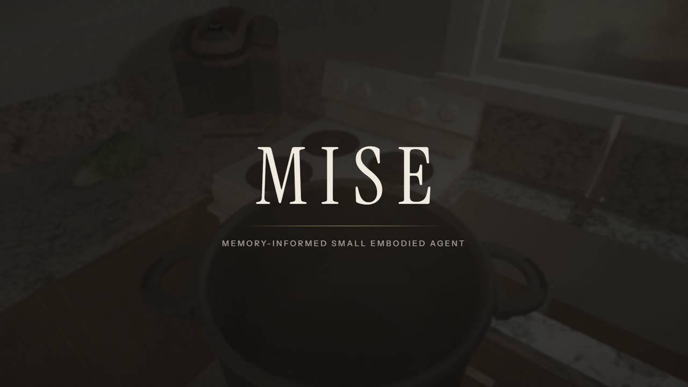
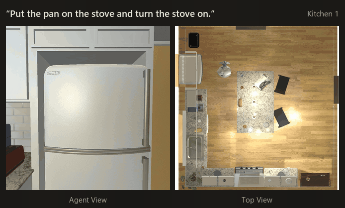

# MISE

[](https://arashnasresfahani.github.io/MISE/)

**Memory-Informed Small Embodied Agent**: a retrieval-based agent that lifts local models to frontier level on robotic scene arrangement.

An LLM + RAG embodied agent for hierarchical task planning in AI2-THOR kitchens.

> **Status: public release.** The code, data and sealed results of MISE. An English paper is in preparation.
> Background: developed as part of an MSc thesis at the University of Tehran (2026).
>
> Project page: <https://arashnasresfahani.github.io/MISE/>

Author: Arash NasrEsfahani · supervisor Dr. Hedieh Sajedi · advisor Dr. Mehdi Tale Masouleh.

An embodied agent that turns a natural-language kitchen command (English or Persian) into actions in the
[AI2-THOR](https://ai2thor.allenai.org/) simulator. A language model plans, a retrieval-augmented memory grounds the plan
in what the agent has seen and learned, and a function library carries the plan out under strict "honest agent" rules.

## The Agent at Work

A real run in Kitchen 1, which reached its goal. Left: the agent's own camera, the only image it uses. Right: a top view for illustration; the agent never sees it.



## What is in it

- **Three-level command hierarchy.** Every instruction, plan and result declares its level:
  **L1** atomic (one command, one skill; Success Rate), **L2** sequential (an ordered chain; Procedural Correctness,
  normalised Levenshtein), **L3** abstract goal (needs decomposition; Task Decomposition Score, F1 over action sets).
  The bilingual instruction set (`sim/dataset/general.json`, 280 instructions x EN + FA) is graded this way.
- **Honest agent** (`sim/honest.py`, `honest_map.py`, `honest_skills.py`, `objmem.py`). The agent reaches the
  simulator only through one audited gateway: it never reads the simulator's ground-truth object list. It builds its own
  map and object memory from what it perceives, and every run reports violations and oracle reads (zero in the evaluation runs).
- **Long-term memory** (`sim/ltm*.py`): a layered store (places, habits, lessons, procedures, per-kitchen briefings) with
  lexical + dense retrieval and provenance, packed into a fixed token budget for the planner.
- **Two-stage YOLO perception** (`sim/perception.py`, `TwoStageDetector`). Per kitchen, a primary YOLO26s detector
  (49 object types, every frame) plus a look-alike specialist YOLO26m (Fork, Spoon, ButterKnife, Knife, Spatula,
  SaltShaker, PepperShaker, Plate, Pot, Pan). The specialist replaces the primary's answer for those classes only while
  the agent holds an object up to inspect it. Per-axis state classifiers (open, sliced, cooked, ...) sit on top.
- **Pluggable planners** (`sim/planners/`): Gemma 4 E2B through Ollama (local), Claude Opus / Sonnet through the
  Anthropic API, Codex CLI and OpenRouter, all behind one interface with caching, a spend ledger and key redaction.
- **Web console** (`sim/webapp.py`, `sim/web/`): run a command live, switch Oracle / Honest agent, inspect the
  agent's map, memory and audit, edit the instruction set, and browse the provenance trace (`/trace`).
- **Kitchens:** iTHOR `FloorPlan1` (development + the Kitchen 1 test), `FloorPlan15` and `FloorPlan17` (held-out
  replication kitchens, Kitchens 2 and 3).
- **Preregistered final test** (`docs/final-test/preregistration.md` + `docs/final-test/amendments/`), with frozen
  code hashes, sealed score journals and the analysis code that produced the reported tables
  (`sim/final_test/matrix/`).

## Repository layout

| Path | Contents |
|---|---|
| `sim/` | agent, skills, perception, memory, planners, evaluation, web console, selftests (`sim/_*_selftest.py`) |
| `sim/final_test/matrix/` | final-test runner (`matrix_run.py`), plan / execute / score, analysis (`analyze.py`, `k23_analyze.py`), Kitchen 2/3 tooling (`k23_*.py`) |
| `sim/final_test/test_run/`, `sim/final_test/k23_run/` | the orchestration scripts used for the Kitchen 1 and Kitchen 2/3 runs |
| `sim/kitchen_v3/`, `sim/kitchen_v3/k23/` | perception data capture, training and the perception test (code only; data and weights are separate) |
| `sim/dataset/` | instruction sets (`general.json`, `commands.jsonl`), scene inventory, reference-plan validation results |
| `docs/` | design notes, setup (`ai2thor-wsl-setup.md`), `PATHS.md` |
| `docs/final-test/` | preregistration, amendments, freeze records, sealed score journals and analysis reports |
| `scripts/reproduce_analysis.py` | re-derives the results tables from the sealed journals |

## Quick start

### 1. Offline checks (Windows or Linux, Python 3.10+, no simulator, no GPU, no LLM)

From the repository root (never from `sim/`, whose `trace.py` shadows the standard-library module):

```bash
pip install numpy
python sim/_agentic_rag_selftest.py
python sim/_step4_rules_selftest.py
python sim/final_test/matrix/_k23_analyze_selftest.py
```

Every `sim/**/_*selftest.py` prints `passed/total` and exits non-zero on a failure. See "Selftests" below.

### 2. Simulator (WSL2 Ubuntu 22.04 + NVIDIA GPU)

AI2-THOR runs inside WSL2 through WSLg with Mesa D3D12 on the NVIDIA GPU. Full bring-up: `docs/ai2thor-wsl-setup.md`.

```bash
conda env create -f environment.yml        # or: python3.10 -m venv ~/thor-env && ~/thor-env/bin/pip install -r sim/requirements.txt
~/thor-env/bin/pip install --index-url https://download.pytorch.org/whl/cu124 "torch==2.6.0" "torchvision==0.21.0"
cd sim && MESA_D3D12_DEFAULT_ADAPTER_NAME=NVIDIA DISPLAY=:0 ~/thor-env/bin/python thor_smoke.py
```

Several scripts hard-code the original machine's paths (`~/thor-env`, `~/thor-data`, the repository location, the Ollama
host IP). **Read `docs/PATHS.md` before running anything in WSL.**

### 3. Planner and console

```bash
ollama pull gemma4:e2b-it-q4_K_M           # local planner (Gemma Terms of Use apply; not redistributed here)
```

On Windows, `START-TESTING.bat` checks Ollama and WSL, repairs the Ollama address in `sim/gui_config.json` and starts the
console at `http://localhost:8000`. `CHECK.html` / `HOW-TO-TEST.html` are guided test checklists.
Anthropic models need `THESIS_ANTHROPIC_API_KEY` (or `ANTHROPIC_API_KEY`); OpenRouter reads `OPENROUTER_API_KEY` from
the `.env` file named by `OPENROUTER_ENV_FILE`. Keys are never written to disk.

### 4. Detector weights (Hugging Face)

The trained detectors are published separately on Hugging Face (the training datasets are
`ArashNasr/ai2thor-kitchen-dataset-floorplan{1,15,17}` and the instruction set `ArashNasr/ai2thor-kitchen-instructions`):

- `ArashNasr/ai2thor-kitchen-perception-floorplan1`
- `ArashNasr/ai2thor-kitchen-perception-floorplan15`
- `ArashNasr/ai2thor-kitchen-perception-floorplan17`

The code looks for them at `sim/weights/v3/<scene>.yolo26s.pt` (primary), `sim/weights/v3/<scene>.amb26m.pt`
(look-alike specialist) and `sim/weights/v3/<scene>.state_<axis>.pt` (state classifiers; their calibration is read from
`sim/kitchen_v3/<scene>/state_calib.json`). Without weights the console falls back to oracle perception and reports it as
`degraded`.

## Reproduce the results tables

```bash
python scripts/reproduce_analysis.py        # ~20 s, numpy only; outputs go to ./reproduced/ (git-ignored)
```

It runs two things:

1. **The registered commands**
   `python sim/final_test/matrix/analyze.py --sealed docs/final-test/matrix/test-v1/score.jsonl --allow-test` and
   `python sim/final_test/matrix/k23_analyze.py --allow-test`. Before reading any test item these re-verify the
   preregistration freeze, which pins files that are not in this release (detector weights, memory snapshots, gate
   evidence, later-re-pinned code). They are therefore expected to print `REFUSED: TestItemRefused ...`: that is the
   blinding guard working.
2. **A post-hoc reproduction**: the same, unmodified analysis functions (`analyze.run_sealed`, `k23_analyze.run`) with
   only the freeze re-verification stubbed out. The seal hash of every score journal, namespace / split membership,
   roster completeness and the Kitchen 1 / Kitchen 2-3 separation are all still checked. The regenerated reports are
   compared line by line with the shipped `docs/final-test/matrix/test-v1/analysis.md` and
   `docs/final-test/k23/analysis/analysis_k23.md`; in this snapshot both are **identical**.

Kitchen 1 (`test-v1`, 125 items x EN + FA), success rate by level (from the shipped `analysis.md`; G = Gemma 4 E2B,
O = Claude Opus 5.5, +M = with the frozen memory, 0 = without):

| arm | overall | L1 | L2 | L3 |
|---|---|---|---|---|
| G0 | 54.0% | 69.1% | 57.0% | 23.2% |
| G+M | 68.4% | 86.2% | 78.0% | 21.4% |
| O0 | 78.0% | 89.4% | 73.0% | 67.9% |
| O+M | 82.0% | 88.3% | 81.0% | 73.2% |

Memory gain for Gemma (H2a, G+M - G0): +14.4 pp [+7.4, +21.6], Holm-adjusted p = 0.0006. Primary hypothesis H1
(G+M - O0 non-inferiority at -5 pp): -9.6 pp, nominal 96.5% interval [-21.0, +1.8], inconclusive. Kitchens 2/3
(two-kitchen average): G+M - G0 +12.7 pp [+5.7, +19.7]. Full tables, intervals, disclosures and the exploratory
systems are in the two reports; post-hoc material is under `docs/final-test/k23/rerun/` and `docs/final-test/k23/decisions/`.

## Selftests

About 130 offline selftests cover the agent rules, map, memory, retrieval, perception tooling, planners, the final-test
pipeline and its guards. The core gates (all offline):

```bash
for t in sim/_agentic_rag_selftest.py sim/_trace_selftest.py sim/_eval_selftest.py \
         sim/_step5_retrieval_selftest.py sim/_search_selftest.py sim/_detector_selftest.py \
         sim/_bench_detect_selftest.py sim/_scan_selftest.py sim/_oracle_eval_selftest.py \
         sim/_general_selftest.py sim/_phase6_selftest.py sim/_phase7_selftest.py \
         sim/_step4_rules_selftest.py sim/_step4_map_selftest.py sim/_step4_act_selftest.py \
         sim/_step5_storage_selftest.py sim/_console_honest_selftest.py \
         sim/perception.py sim/skills.py; do
  python "$t" > /dev/null && echo "ok   $t" || echo "FAIL $t"
done
```

In this snapshot, on Windows with Python 3.14 and no WSL, 77 of the 127 selftests pass, including every core gate listed
above and `sim/final_test/matrix/_k23_analyze_selftest.py`. The others check the original working tree and fail in a
fresh clone by design: they need files that are not shipped (pre-change checkpoint copies, practice / rehearsal journals,
gate evidence, Kitchen 2/3 maps and memory tables, acceptance-phase and signal-round scripts, detector weights, e.g.
`_motion_selftest.py` wants `sim/weights/FloorPlan1_physics.pt`), compare against the frozen sha256 manifests, need
`ultralytics` (WSL side), or need WSL. That is expected and is not a code defect.

## Related toolkit

[AI2-THOR Web Console](https://github.com/ArashNasrEsfahani/ai2thor-web-console-extension) contains the browser console and Python agent toolkit extracted from MISE, offered as a starting point for similar embodied-agent projects in AI2-THOR.

## Licence

GNU Affero General Public License v3.0 (`LICENSE`). Third-party components, fonts (SIL OFL 1.1, `OFL.txt`) and model
terms are listed in `NOTICE`.
